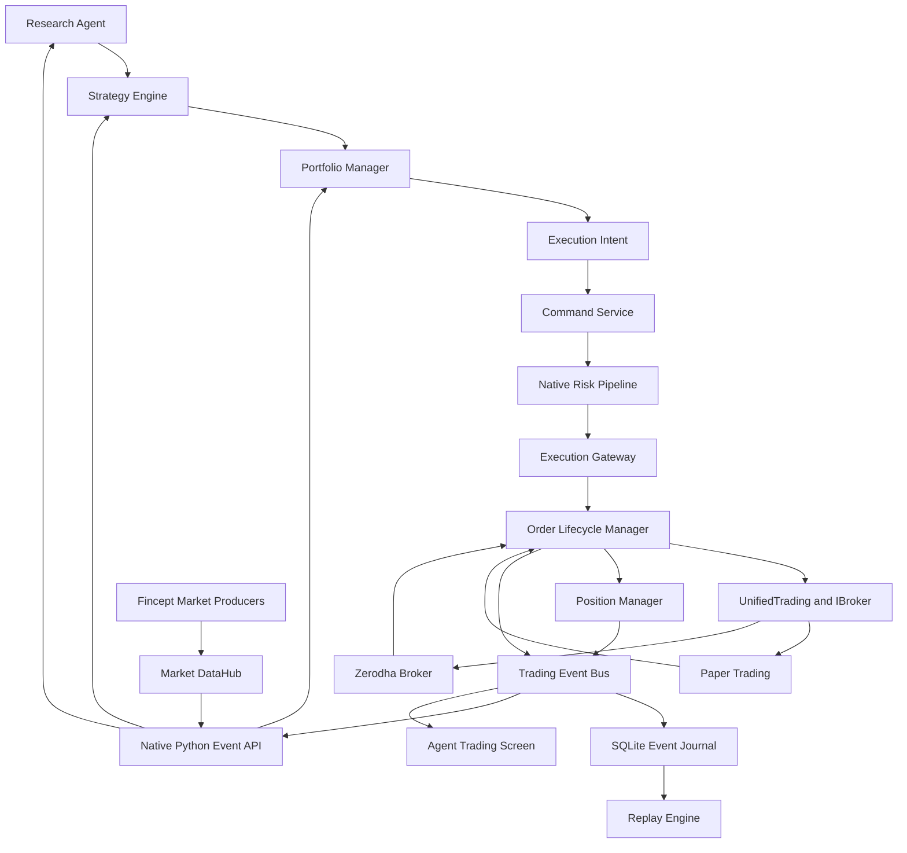

# Fincept Native Agent Integration Design

## 1. Objective

Integrate this repository's Python trading agents directly into a maintained FinceptTerminal fork. FinceptTerminal becomes the execution, brokerage, market-data, account-state, and desktop UI layer. The Python agents remain responsible for research, strategy generation, portfolio construction, and risk authorization.

The integration is in-process. FinceptTerminal embeds CPython 3.12 and exposes a typed native Python module backed by Fincept's C++ services. MCP, HTTP, and a separately managed agent daemon are out of scope.

Phase 1 supports Zerodha paper and Zerodha live trading. It exposes trading-critical data only: instruments, ticks, quotes, candles, funds, orders, holdings, positions, executions, and account/session state. News, fundamentals, economics, and alternative-data bindings follow after the execution path is proven.

## 2. Preconditions

- Maintain a source fork of FinceptTerminal and compile it locally.
- Resolve FinceptTerminal's commercial licensing requirements in writing before any business or live organizational use.
- Upgrade the fork's Python runtime from its pinned Python 3.11 environment to CPython 3.12, matching this project's `requires-python` constraint.
- Keep the Fincept fork and this agent repository independently versioned. During development, Fincept may load an editable install of this package. Release builds install a pinned wheel with a recorded version and SHA-256 hash into Fincept's managed Python environment.

## 3. Design Principles

1. Fincept owns credentials, broker sessions, market connectivity, order routing, fills, account state, hard risk controls, and UI state.
2. Agents own analysis, decisions, portfolio targets, and risk recommendations. They never receive broker credentials.
3. Strategies cannot submit orders. A portfolio manager converts strategy decisions into execution intents.
4. Agent risk approval is necessary but not sufficient. A native risk pipeline must independently approve every live command.
5. Market data is state; trading events are history. They use different pipelines.
6. Commands and events are distinct. Commands request effects; events record observed state transitions.
7. No blind order retry is permitted after an uncertain broker outcome.
8. Paper and live modes share domain contracts but have separate sessions, state, policies, and ledgers.
9. Existing Fincept broker abstractions are extended, not duplicated.
10. Every state transition is attributable, versioned, measurable, and replayable.

## 4. System Architecture

## 5. Runtime and Binding Boundary

### 5.1 PythonAgentRuntime

`PythonAgentRuntime` is a native Fincept service responsible for:

- Initializing and shutting down CPython exactly once.
- Creating a dedicated agent thread and asyncio event loop.
- Importing the pinned trading-system package.
- Starting and stopping agent lifecycles.
- Reporting runtime health, package version, exceptions, queue depth, and heartbeat age.
- Preventing Python work from running on the Qt UI, broker callback, or market-data threads.

All C++ to Python callbacks are queued onto the agent thread. All Python to C++ operations are marshalled to the owning Qt thread or a bounded worker pool. The GIL is never held while waiting synchronously on Qt or broker network work.

### 5.2 `fincept_native` module

The pybind11 module exposes stable DTOs and services, not raw `QObject`, `IBroker`, credentials, repositories, or pointers.

Initial surface:

- `market.subscribe_ticks(symbols, callback)`
- `market.unsubscribe(handle)`
- `market.get_quote(account_id, instrument)`
- `market.get_candles(account_id, instrument, timeframe, start, end)`
- `instruments.resolve(query)`
- `account.get_snapshot(account_id)`
- `commands.submit(execution_intent, risk_approval)`
- `commands.cancel(command_id)`
- `execution.modify(intent)`
- `execution.cancel(intent)`
- `events.subscribe(types, callback, consumer_id)`
- `events.replay(from_sequence, types)`
- `safety.get_policy(account_id, mode)`
- `safety.activate_kill_switch(reason)`
- `runtime.health()`

Bindings return immutable value objects or futures. Subscription methods return opaque handles with deterministic cleanup.

## 6. Purpose-Built Data Pipelines

### 6.1 Market DataHub

Fincept's existing `DataHub` remains the market and research data plane. Market delivery is:

- High frequency.
- Non-durable by default.
- Coalesced by symbol/topic.
- Bounded with latest-value-wins backpressure.
- Allowed to drop intermediate ticks when Python is behind.

The Python bridge maintains a bounded conflation queue keyed by instrument. It records dropped/coalesced counts as metrics. Optional audit capture writes selected raw market topics into a separate capture store; normal operation does not persist every tick.

### 6.2 TradingEventBus

Trading lifecycle events use a new native `TradingEventBus` with these guarantees:

- Events are committed to SQLite before publication.
- A global monotonically increasing sequence defines replay order.
- Persistence is exactly once under a unique `event_id`.
- Delivery is at least once.
- Consumers achieve effectively-once effects through event-id deduplication and persisted offsets.
- Slow consumers do not block order processing.
- Failed consumers resume from their last committed offset.

Existing Fincept screens may receive compatibility projections from trading events during migration. The durable trading journal, not those projections, is authoritative.

## 7. Command Service

The native `CommandService` receives immutable `ExecutionIntent` objects and owns:

- Persistence before processing.
- Idempotency and duplicate rejection.
- Command expiry and cancellation.
- Risk-pipeline invocation.
- Command state transitions.
- Safe retry classification.
- Recovery of incomplete commands after restart.
- Transactional publication through an outbox.

Command states are:

`RECEIVED -> PERSISTED -> RISK_APPROVED -> DISPATCHED -> ACKNOWLEDGED -> COMPLETED`

Alternative terminal or exceptional states are `RISK_REJECTED`, `EXPIRED`, `CANCELLED`, `FAILED`, and `OUTCOME_UNKNOWN`.

`OUTCOME_UNKNOWN` means the broker request may have succeeded but Fincept did not receive a definitive result. It starts reconciliation and never causes a blind resubmission.

The idempotency key is unique within `(mode, account_id, client_order_id)`. Reusing the same key with identical content returns the existing command. Reusing it with different content is rejected and audited.

## 8. Portfolio and Risk Flow

The strategy layer emits decisions and desired exposures, not orders. The portfolio manager considers cash, current positions, pending exposure, leverage, concentration, correlations, allocations, and turnover before creating an execution intent.

The intent includes an agent-generated `RiskApproval` record. The native risk pipeline then evaluates immutable stages in fail-fast order:

1. Global and account kill switches.
2. Session mode, account connection, token health, and live-session arming.
3. Intent freshness, schema support, and idempotency.
4. Instrument resolution, exchange session, price freshness, and market state.
5. Broker and exchange rules, product rules, lot size, tick size, freeze quantity, and margin.
6. Account cash, margin, daily loss, and drawdown limits.
7. Existing plus pending gross/net exposure and concentration limits.
8. Portfolio allocation and correlation limits.
9. Strategy-specific limits and approved strategy status.
10. Agent risk approval identity, scope, version, and expiry.

Every stage returns a typed pass, reject, or error result with a reason code. A rejection emits a durable event and never reaches `UnifiedTrading`.

## 9. Execution and Order Lifecycle

`ExecutionGateway` is the only component permitted to call Fincept's `UnifiedTrading` for agent-originated commands. It selects paper or live routing from the persisted account/session policy; Python cannot override the mode at call time.

`OrderLifecycleManager` owns:

- Broker submission and acknowledgement mapping.
- Legal state transitions.
- Partial-fill aggregation.
- Cancellation and modification state.
- Broker and client order-ID correlation.
- Command timeouts.
- Duplicate response suppression.
- Active-order reconciliation.
- Restart recovery.

Normalized lifecycle events include `ORDER_SUBMITTED`, `ORDER_ACCEPTED`, `ORDER_REJECTED`, `PARTIAL_FILL`, `FILLED`, `CANCEL_PENDING`, `CANCELLED`, `EXPIRED`, and `ORDER_OUTCOME_UNKNOWN`.

Fincept currently receives live Zerodha market ticks but refreshes orders, positions, holdings, and funds on a slow polling cadence. Phase 1 therefore adds an execution reconciler:

- Refresh immediately after submit, modify, or cancel.
- Poll active orders and the trade book rapidly while any order is non-terminal.
- Back off when all orders are terminal.
- Detect stale/disconnected broker state and block new live commands.
- Convert snapshot differences into normalized lifecycle events.
- Prefer a verified broker push update when available; polling remains the fallback.

## 10. Position Manager

`PositionManager` is the local operational source of truth. It applies fills to maintain quantities, average price, realized PnL, unrealized PnL, pending exposure, and portfolio snapshots.

Broker state remains the external authority during reconciliation. Differences are never silently overwritten. The manager emits events such as `POSITION_RECONCILIATION_STARTED`, `POSITION_MISMATCH_DETECTED`, `POSITION_CORRECTED`, and `POSITION_RECONCILIATION_FAILED`, preserving both local and broker values.

Paper and live positions are stored in separate ledgers. No command, event, snapshot, or replay offset may cross modes.

## 11. Event and Schema Contracts

Every trading event carries:

- `event_id`
- `event_sequence`
- `event_type`
- `event_schema_version`
- `intent_id`
- `decision_id`
- `strategy_id`
- `portfolio_id`
- `account_id`
- `session_id`
- `correlation_id`
- `causation_id`
- `command_id`
- `client_order_id`
- `broker_order_id` when known
- `mode`
- `occurred_at`
- `recorded_at`
- `risk_policy_version`
- `broker_adapter_version`
- `application_build_id`
- typed payload

Execution intents carry `intent_schema_version`. Unsupported major versions are rejected. Minor additive changes remain backward compatible. Event upcasters convert older persisted payloads to the current in-memory contract without rewriting history.

## 12. Storage and Recovery

The append-only SQLite journal contains logical stores for commands, events, transactional outbox records, consumer offsets, order projections, position snapshots, reconciliation records, and risk-policy versions.

SQLite uses WAL mode, foreign keys, explicit transactions, integrity checks, and versioned migrations. Events are immutable. Corrections are new events.

Startup recovery performs:

1. Database integrity and migration checks.
2. Outbox republishing.
3. Projection rebuild or verification.
4. Recovery of non-terminal commands and orders.
5. Broker reconciliation before live execution is enabled.
6. Python consumer resume from persisted offsets.

JSONL is supported only as an import/export and portable replay-bundle format.

## 13. Replay

The replay engine reads the same normalized trading events used by live and paper operation. It supports deterministic ordering, a controllable clock, pause/resume, speed control, filtering, and isolated replay sessions.

Trading-event replay reconstructs decisions, commands, orders, fills, positions, and PnL. Strategy backtesting additionally requires a separately captured or historical market-data stream. A replay never writes into live or paper ledgers and cannot invoke a live broker adapter.

## 14. Live-Trading Safety

- Live mode is disabled by default after every installation and database reset.
- A user must explicitly arm a Zerodha live session in the UI; arming expires and is account-specific.
- Automatic orders require an approved strategy, an unexpired agent risk approval, and a passing native risk pipeline.
- The native global kill switch rejects new commands and initiates the configured cancellation policy.
- Credentials remain exclusively in Fincept's credential store.
- Python cannot call `IBroker`, `BrokerRegistry`, or `UnifiedTrading` directly.
- Paper mode is the mandatory soak environment before a strategy may be approved for live use.
- Restart, stale broker state, reconciliation failure, journal failure, Python heartbeat failure, or clock anomaly disarms live execution.

## 15. Agent Trading Screen

A dedicated Fincept `AgentTradingScreen` reuses existing chart, order-book, positions, and account widgets where their data contracts are compatible. It adds:

- Runtime and broker connection health.
- Paper/live mode and live-session arming state.
- Agent and approved-strategy status.
- Decision and execution-intent timeline.
- Risk-pipeline stage results.
- Commands, orders, partial fills, and fills.
- Positions, pending exposure, realized/unrealized PnL, and reconciliation status.
- Hard limits and kill-switch controls.
- End-to-end latency and queue-health metrics.
- Event inspection and replay controls.

The screen renders projections from the market and trading pipelines. It does not issue broker calls directly.

## 16. Observability

Record wall-clock timestamps and monotonic durations for:

- Decision to intent.
- Intent to persistence.
- Persistence to risk decision.
- Approval to broker submission.
- Submission to acknowledgement.
- Acknowledgement to each fill.
- Fill to position update.
- Unknown outcome to reconciliation.

Additional metrics cover Python queue depth, coalesced market ticks, event consumer lag, outbox backlog, active-order reconciliation age, broker errors, rejected risk stages, and SQLite commit latency. Logs include correlation and causation IDs but never credentials or access tokens.

## 17. Testing Strategy

### Unit tests

- DTO and schema validation.
- Event upcasting.
- Command idempotency and conflict rejection.
- Every risk-pipeline stage.
- Order state-machine legality.
- Fill aggregation and position/PnL calculations.
- Market-data conflation and backpressure.

### Integration tests

- Embedded Python lifecycle and exception isolation.
- Qt thread-affinity and GIL behavior.
- SQLite transaction/outbox crash recovery.
- Paper command through fill and position update.
- Zerodha response normalization using recorded fixtures.
- Timeout-after-acceptance producing `OUTCOME_UNKNOWN` without duplicate submission.
- Restart with active orders followed by reconciliation.
- Consumer replay and offset recovery.

### End-to-end gates

1. Deterministic replay tests.
2. Paper soak with forced disconnects, restarts, partial fills, rejects, and stale data.
3. Live read-only account reconciliation.
4. Live minimum-size canary orders with manual session arming.
5. Automated live execution only after all safety gates pass.

## 18. Delivery Sequence

1. Establish the Fincept fork, licence prerequisite, reproducible build, Python 3.12 runtime, and pinned agent package.
2. Add the embedded runtime and read-only native market/account bindings.
3. Add schemas, SQLite journal, trading event bus, and Python event subscriptions.
4. Add command service and native risk pipeline with paper-only routing.
5. Add order lifecycle, position manager, and reconciliation.
6. Add the dedicated Agent Trading screen and operational controls.
7. Complete paper soak, replay, recovery, and fault-injection testing.
8. Add Zerodha live read-only mode, then canary execution, then approved automatic execution.
9. Add broader Fincept research-data bindings after the trading path meets acceptance criteria.

## 19. Acceptance Criteria

- Agents run in-process on CPython 3.12 without blocking Fincept's UI or broker threads.
- Strategies cannot bypass portfolio management, command persistence, agent approval, or native risk checks.
- Duplicate intents cannot create duplicate broker effects.
- Unknown broker outcomes reconcile without blind retry.
- All command, order, fill, position, risk, and reconciliation transitions are durably ordered and replayable.
- Market-data overload causes measured coalescing, not unbounded memory growth or trading-event loss.
- Paper and live state are demonstrably isolated.
- Restart recovery reconstructs projections and reconciles active Zerodha state before re-enabling execution.
- The kill switch operates independently of Python health.
- The dedicated UI shows the complete causal chain from decision through position and PnL.
- Automatic Zerodha live execution remains impossible until explicit arming, approved strategy status, valid agent approval, healthy broker state, and all native risk stages pass.

## 20. Non-Goals for Phase 1

- MCP or external network APIs for agents.
- Supporting brokers other than Zerodha.
- Binding raw Fincept C++ objects into Python.
- Persisting every market tick during normal operation.
- Replacing Fincept's existing broker registry or unified trading layer.
- Rewriting the Python agents in C++.
- Adding research feeds before the execution path is production-ready.
