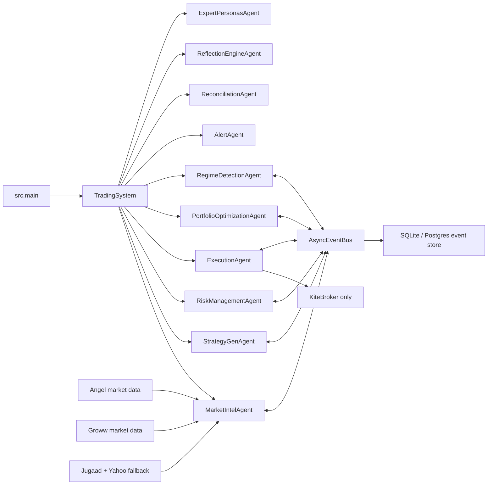
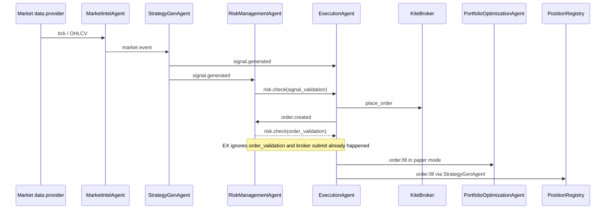
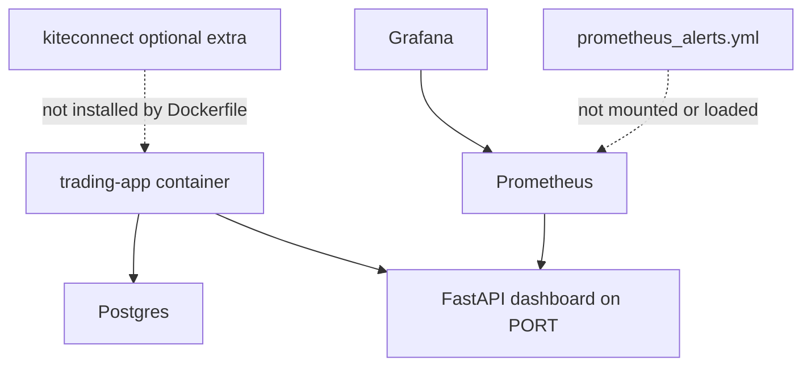

# Trading Engine Bottom-Up Audit

Audit date: 2026-06-02  
Workspace: `D:\projects\new trade`  
Snapshot reviewed: `75ee77d534cc843c1d5a146262132c55e6874114` plus visible uncommitted dashboard changes  
Target context: personal NSE large-cap trading system, approximately INR 10 lakh capital, paper first, then carefully gated live trading

## Evidence Labels

- `[VERIFIED]`: confirmed directly from source, a deterministic probe, a focused test, or a repository artifact.
- `[LIKELY]`: strongly supported by the implementation, but not exercised end to end against a live broker.
- `[SPECULATIVE]`: plausible concern that needs runtime or market evidence.
- `[IRRELEVANT TO CURRENT SCALE]`: valid engineering topic, but not a priority for a personal INR 10 lakh system.

## Executive Verdict

The codebase is not ready for safe paper trading through its intended signal-to-risk-to-execution pipeline, and it is not ready for live trading.

The most important current defect is simple: every signal risk validation crashes before it emits an approval or rejection. After that is fixed, execution still submits an order before order-level risk validation can block it, then raises a post-submit `NameError`. Live fill tracking is also incomplete: fills are simulated in paper mode or recovered on startup, but there is no continuous broker order-status ingestion loop.

The repository contains useful building blocks: explicit agents, an event bus, a transaction-cost model, paper fills, kill-switch mechanics, reconciliation attempts, dashboard endpoints, and several plausible NSE intraday strategy ideas. The system is overextended relative to its proven core, however. It has multiple position stores, two reconciliation implementations, inactive strategy paths, institutional-style optimization without reliable attribution, stale abstractions, and no valid profitability evidence.

Direct answers:

| Question | Answer |
| --- | --- |
| Can it paper trade safely today? | **No.** `[VERIFIED]` Signal risk validation crashes at `src/agents/risk_mgmt.py:96`. |
| Can it live trade safely today? | **No.** `[VERIFIED]` Broker submission precedes effective order-level risk blocking, live fills are not continuously ingested, Groww execution is absent, and the public FastAPI dashboard exposes control actions without authentication. |
| Can one bug wipe the account? | **Potentially yes after superficial live enablement.** `[VERIFIED]` An order can be submitted before order validation, and local position state can diverge from broker state. The current signal crash prevents the normal pipeline from reaching that point, but it is not a safety mechanism. |
| Is positive expectancy established? | **No.** `[VERIFIED]` Current result JSON files are empty and the comparison log reports synthetic fallback with zero valid trades. |
| Is the design appropriate for the stated scope? | **Partially.** The core agent flow is understandable, but too many unproven components are active before the simple paper path is trustworthy. |

## 1. Actual Runtime Architecture

### Main Process

`src/main.py:120-143` creates one `TradingSystem`, sets a watchlist, starts all agents, and selects either the FastAPI dashboard or the smaller HTTP metrics server.

`src/system.py:36-55` selects market data in this order:

1. Angel market data if Angel credentials exist.
2. Groww market data if Groww credentials exist.
3. Jugaad plus Yahoo polling as fallback.

`src/system.py:44-47` separately wires Kite as the only live execution broker. Groww is a market-data provider only.



### Intended Trading Flow



### Deployment Shape

`Dockerfile:20` installs `.[dashboard]`, not `.[kite]` or `.[ml]`. `docker-compose.yml:59-68` selects Postgres and passes Groww and Kite credentials. `prometheus.yml` scrapes `/metrics`, but no alert rules are loaded.



## 2. Critical Findings

### P0-1: Signal risk validation always crashes

`[VERIFIED]` `src/agents/risk_mgmt.py:96-97`

```python
start_time = time.monotonic()
import time
```

The local import makes `time` a local variable, so line 96 raises `UnboundLocalError` before any check runs. Focused verification:

```text
uv run pytest -q tests/test_risk_mgmt_phase2.py
3 failed
UnboundLocalError: cannot access local variable 'time'
```

Impact: generated signals stall at the risk boundary. The normal paper pipeline cannot approve, reject, or execute trades.

### P0-2: Execution crashes after an order is emitted or submitted

`[VERIFIED]` `src/agents/execution.py:459-570`

`_execute_approved_signal()` records latency using `start_time` at line 570, but that variable is never defined in the method. A direct paper probe created and filled an order, then failed:

```text
NameError name 'start_time' is not defined
Order APPROVED and placed: buy RELIANCE 5 @ 100.00
Fill simulated: RELIANCE 5 @ 100.05
```

Impact: state mutation occurs before the exception. In live mode, the broker call at `src/agents/execution.py:546-555` also happens before this failure.

### P0-3: Order-level risk validation cannot block broker submission

`[VERIFIED]` `src/agents/execution.py:420-428`, `src/agents/execution.py:532-560`, `src/agents/risk_mgmt.py:205-230`

Execution only processes `signal_validation`. It explicitly ignores `order_validation`. For a live broker, the code calls `broker.place_order()` first and emits `order.created` afterward. RiskManagementAgent validates the already-created order later.

Impact: order size and exposure checks are advisory after submission, not pre-trade controls.

### P0-4: Live fill processing is incomplete

`[VERIFIED]` `src/agents/execution.py:861-906`, `src/agents/execution.py:982-1043`

`FillEvent.create()` is used for:

- paper simulation in `_simulate_fill()`;
- startup recovery in `reconcile_orders()`.

No continuous broker order-status polling, trade polling, or websocket fill ingestion path exists. The `PARTIALLY_FILLED` schema state exists at `src/schemas/events.py:47`, but live partial-fill handling is absent.

Impact: after a live order is accepted during normal runtime, portfolio state, risk state, SL/TP state, and the dashboard can remain stale until restart.

### P0-5: Risk exposure units are inconsistent and leverage is not enforced

`[VERIFIED]` `src/agents/risk_mgmt.py:250-269`, `src/agents/risk_mgmt.py:313-318`

`get_total_exposure()` sums absolute share quantities. That value is compared against `risk_max_position_size`, configured as INR 100,000 at `src/config/settings.py:52`. Order validation then adds rupee `order_value` to quantity-based exposure at `src/agents/risk_mgmt.py:215`.

`risk_max_leverage` is loaded and logged at `src/agents/risk_mgmt.py:27,48-52`, but repository search found no enforcement.

Impact: exposure decisions are dimensionally invalid.

### P0-6: Position truth is split across multiple stores

`[VERIFIED]`

- `PositionRegistry`: `src/risk/position_registry.py:1-8`
- Strategy fill writer: `src/agents/strategy_gen.py:142-177`
- Portfolio local store: `src/agents/portfolio.py:80-148`
- Risk local quantity store: `src/agents/risk_mgmt.py:233-251`
- Broker positions: external source of truth

The registry documentation says only PortfolioOptimizationAgent should write it, but StrategyGenAgent writes it. Runtime reconciliation at `src/risk/reconciliation.py:77-90` updates only the portfolio-local store. The separate `ReconciliationAgent` compares broker positions to the registry at `src/agents/reconciliation.py:47-97` but only alerts.

Impact: a reconciliation can make one local store correct while leaving risk and SL/TP state stale.

### P0-7: FastAPI control endpoints are unauthenticated

`[VERIFIED]` `dashboard/server.py:546-575`

The deployed FastAPI application exposes candidate approval and kill-switch reset endpoints without authentication middleware. The emergency-stop endpoint returns an acknowledgement but does not trigger `KillSwitch.trigger()`.

`src/main.py:48-68` has bearer-token logic only for the smaller hand-written HTTP server. Docker selects FastAPI with `TRA_DASHBOARD_TYPE=fastapi` at `Dockerfile:28`.

Impact: if the dashboard is reachable, a remote caller can reset a triggered kill switch or approve candidate behavior. The emergency-stop UI can also claim success without stopping trading.

### P0-8: Intended Groww live trading is not implemented

`[VERIFIED]` `src/system.py:40-47`, `src/connectors/groww/client.py:34-57`

Groww is wired only for market data. Kite is the only execution broker. The initial Groww HTTP client builds headers without passing the configured credential:

```python
headers=self._build_headers()
```

A deterministic probe returned:

```text
{'default_authorization': '', 'explicit_authorization_present': True}
```

The official Groww REST documentation requires `Authorization: Bearer {ACCESS_TOKEN}` for order endpoints and documents create, modify, cancel, status, and trade-list APIs. Those execution paths are not represented in this codebase.

Sources:

- [Groww REST order API](https://groww.in/trade-api/docs/curl/orders)
- [Groww Python SDK introduction](https://groww.in/trade-api/docs/python-sdk)

## 3. High-Priority Reliability Findings

### Kite placeholder mode can look live

`[VERIFIED]` `src/connectors/kite/client.py:21-40`, `src/connectors/kite/client.py:72-79`, `Dockerfile:20`

If `kiteconnect` is missing, KiteClient sets `_connected = True` and falls back to fake `paper_*` order IDs. Docker does not install the Kite extra. Because the broker object still exists, the dashboard can report broker availability using object presence at `dashboard/server.py:42-48`.

### Metrics export fails with KiteBroker

`[VERIFIED]` `src/monitoring/metrics.py:86-93`

Metrics calls `broker._client.is_connected()` as a method, but KiteClient exposes `is_connected` as a property at `src/connectors/kite/client.py:17-19`.

Probe:

```text
TypeError 'bool' object is not callable
```

### Dashboard reconciliation health is fabricated

`[VERIFIED]` `dashboard/server.py:102-109`

When a broker appears available, the dashboard always returns `"matched": true`, zero cash delta, zero portfolio delta, and empty share deltas. It does not read reconciliation results.

### Postgres pools leak during agent startup

`[VERIFIED]` `src/agents/base.py:66-74`, `src/event_store/postgres.py:21-23`

Every agent calls the same event store's `connect()`. SQLite guards repeated connects; Postgres does not. Each call creates and overwrites a pool, leaking earlier pools. Docker Compose uses Postgres.

### Event persistence tasks are untracked

`[VERIFIED]` `src/event_store/async_bus.py:82-89`

SQLite and Postgres appends are launched with `asyncio.create_task()` and are not tracked, awaited at shutdown, or given error callbacks.

### Event bus subscribers are never removed

`[VERIFIED]` `src/event_store/async_bus.py:40-45`, `src/agents/base.py:161-169`

Queues are registered globally but no unsubscribe path exists. This matters for in-process restarts and tests. It is less important for a process that is always terminated and relaunched.

### Reconciliation exists twice with different truth models

`[VERIFIED]`

- `src/risk/reconciliation.py:7-90` reconciles broker -> portfolio-local positions.
- `src/agents/reconciliation.py:12-97` compares broker -> PositionRegistry and alerts only.

The duplicate implementations create ambiguity and inconsistent repair semantics.

## 4. Runtime Logic Findings

### Regime detection cannot transition away from its initial regime

`[VERIFIED]` `src/agents/regime.py:102-137`

For every differing candidate regime, `_pending_since` is reset to the current time and the method returns. The acceptance branch is reached only when the newly classified regime equals the current regime.

Focused verification:

```text
uv run pytest -q tests/test_regime.py
1 failed
assert 'mean_reverting' == 'trending_up'
```

### Correlation risk checks the wrong agent

`[VERIFIED]` `src/agents/risk_mgmt.py:415-419`

RiskManagementAgent expects `system.market_intel._candle_prices`. Candle histories live on StrategyGenAgent at `src/agents/strategy_gen.py:345-377`. In the actual system, correlation risk fails open.

### Liquidity risk fails open during missing-data conditions

`[VERIFIED]` `src/agents/risk_mgmt.py:361-379`

Missing volume data passes the liquidity check. Groww LTP ticks set `"volume": None` at `src/connectors/groww/market_data.py:74-79`.

### Stale pending signals expire only when another signal arrives

`[VERIFIED]` `src/agents/execution.py:417-418`, `src/agents/execution.py:572-583`

There is no timer-driven cleanup loop for pending signal approvals.

### Market-hour logic is incomplete

`[LIKELY]` `src/agents/risk_mgmt.py:73-93`

Time windows are enforced, but weekday and NSE holiday calendar checks are not visible. This should be explicit before live mode.

### Higher-timeframe aggregation uses buffer counts, not exchange boundaries

`[VERIFIED]` `src/agents/market_intel.py:146-175`

The implementation emits when `len(buf) % n_candles == 0`. If the feed starts at an off-boundary minute, 5-minute and larger bars are shifted.

## 5. Strategy Audit

The default strategy portfolio is broad: `src/config/strategy_config.py:9-97`. The active weights are summed rather than normalized at `src/agents/strategy_gen.py:400-445`. Runtime thresholds default to `0.4` and `0.5` at `src/agents/strategy_gen.py:47-59`; configured consensus thresholds are loaded only when a config path is supplied, but `TradingSystem` constructs StrategyGenAgent without one at `src/system.py:61`.

| Strategy | Current assessment | Evidence |
| --- | --- | --- |
| Momentum | `[LIKELY]` Reasonable simple paper baseline. Keep as a control, not as proven alpha. | `src/strategies/technical.py:7-42` |
| Mean reversion | `[LIKELY]` Reasonable large-cap paper candidate with regime gating after regime bug repair. | `src/strategies/technical.py:45-83` |
| ATR breakout | `[VERIFIED]` Confidence is dimensionally wrong: fractional return is divided by rupee ATR. | `src/strategies/technical.py:133-138` |
| Bollinger | `[LIKELY]` Reasonable baseline component; needs cost-aware walk-forward testing. | `src/strategies/technical.py:151-192` |
| RSI | `[LIKELY]` Reasonable baseline component; not standalone proof of edge. | `src/strategies/technical.py:195-246` |
| MACD | `[LIKELY]` Reasonable baseline component; likely correlated with momentum votes. | `src/strategies/technical.py:249-301` |
| Volume | `[VERIFIED]` Disabled by default. Groww LTP lacks volume, so data assumptions need care. | `src/config/strategy_config.py:41-45` |
| Ichimoku | `[VERIFIED]` Disabled by default. Defer. | `src/config/strategy_config.py:46-50` |
| Stat arb | `[VERIFIED]` Uses a raw 1:1 price spread and emits independent legs. No hedge ratio or atomic paired execution. Do not live trade it. | `src/strategies/stat_arb.py:50-80` |
| Volatility breakout | `[LIKELY]` Plausible intraday candidate for liquid large caps. Validate after core fixes. | `src/strategies/vol_breakout.py` |
| ML regime | `[VERIFIED]` Disabled. Defer until deterministic strategies and datasets are trustworthy. | `src/config/strategy_config.py:61-65` |
| Microstructure | `[VERIFIED]` Inert with Groww LTP because it requires depth, bid, and ask. | `src/strategies/microstructure.py:38-44` |
| ORB | `[LIKELY]` One of the better scope-fit candidates for NSE intraday paper testing. | `src/strategies/opening_range_breakout.py` |
| Volatility compression | `[VERIFIED]` Plausible candidate, but its stop override is silently ignored because it emits only `sl_pct_override` while StrategyGen requires both SL and TP override keys. | `src/strategies/volatility_compression.py:115-132`, `src/agents/strategy_gen.py:616-621` |
| TSMOM | `[VERIFIED]` Runtime-unreachable: strategy expects timeframe `"1d"` while historical load emits `"day"`. It also needs 252 daily prices while startup loads only 30 days. | `src/strategies/tsmom.py:15-32`, `src/agents/market_intel.py:267-284`, `src/agents/strategy_gen.py:407-410` |
| Sideways reversion | `[LIKELY]` Scope-fit paper candidate after regime and data fixes. | `src/strategies/sideways_reversion.py` |
| PCA stat arb | `[LIKELY]` Inert in the default Docker image because the ML extra is not installed. Paired execution concerns remain. Defer. | `src/config/strategy_config.py:91-95`, `Dockerfile:20` |

Recommended initial strategy set:

1. Keep momentum as a benchmark.
2. Paper test ORB, volatility compression, sideways reversion, and volatility breakout individually.
3. Defer stat arb, PCA stat arb, microstructure, TSMOM, ML regime, HRP, HMM, and meta-labeling until data and execution paths support them.
4. Do not combine strategies into an ensemble until each component has independent cost-aware evidence and vote normalization is explicit.

## 6. Paper Execution Realism

`[VERIFIED]` Paper simulation adds 50-150 ms latency, transaction costs, depth-aware slippage when depth exists, and a fill event at `src/agents/execution.py:861-906`.

This is a useful starting simulator, but it always fills the full quantity immediately after one short delay. Missing paper-model behavior:

- partial fills;
- rejected orders;
- stale quotes;
- spread variation when no depth exists;
- limit-order queue behavior;
- exchange-session transitions;
- order-status transitions over time.

For the current capital and large-cap NSE focus, this model is acceptable for early functional smoke tests. It is not sufficient for profitability claims.

## 7. Profitability Evidence

### Existing evidence is invalid or absent

`[VERIFIED]`

- `results_1yr.json` is `{}`.
- `results_5yr.json` is `{}`.
- `logs/backtest_compare.log` reports Yahoo DNS failures, Jugaad fallback failure, synthetic data fallback, insufficient dates, and zero trades for every compared strategy.
- `state/burnin/reconciliation.jsonl` records a paper burn-in with zero open orders, zero fills, and zero positions across the captured samples.

### Current full-system backtester is also invalid

`[VERIFIED]` `scripts/run_system_backtest.py:49-56`

The loop assigns a closure over `original_start` without binding the loop value. Every patched `agent.start` resolves the final bound method when later called. That prevents the backtest runner from starting the intended set of agents correctly.

### Realistic profitability conclusion

There is no evidence that the current strategy portfolio has positive expectancy after NSE costs and slippage. A profitable system is possible only after a narrower paper system is made deterministic and each strategy is validated with clean historical data, walk-forward splits, cost sensitivity, and live-paper reconciliation.

## 8. Observability Audit

### Present

- in-memory metrics collector;
- Prometheus scrape endpoint;
- Grafana container;
- dashboard health and paper-report routes;
- alert agent;
- latency JSONL tracer;
- paper burn-in reconciliation snapshots;
- kill-switch metric.

### Missing or misleading

- `[VERIFIED]` Metrics export can fail with KiteBroker due to property invocation.
- `[VERIFIED]` Dashboard reconciliation health is fabricated.
- `[VERIFIED]` `errors_by_component` exists, but production source does not call `count_error()`; repository search found only tests.
- `[VERIFIED]` `prometheus_alerts.yml` exists but `prometheus.yml` has no `rule_files`, Docker Compose does not mount the alerts file, and no Alertmanager service is configured.
- `[VERIFIED]` FastAPI controls have no authentication.
- `[LIKELY]` Operationally important broker order-state lag will be invisible without runtime fill/status polling.

## 9. Dead Code and Unused Abstractions

Repository search found definitions without runtime consumers:

| Component | Assessment | Evidence |
| --- | --- | --- |
| `KafkaEventStore` | `[VERIFIED]` Settings allow Kafka conceptually, but `create_event_store()` supports only Postgres, SQLite, and memory. | `src/event_store/kafka.py`, `src/event_store/__init__.py:6-18` |
| `HMMRegimeClassifier` | `[VERIFIED]` No runtime consumer found. | `src/core/regime/hmm_classifier.py` |
| `TripleBarrierMetaLabeler` | `[VERIFIED]` No runtime consumer found. | `src/ml/meta_labeler.py` |
| `HierarchicalRiskParity` | `[VERIFIED]` No runtime consumer found. | `src/portfolio/hrp_allocator.py` |
| `StrategyDecayDetector` | `[VERIFIED]` No runtime consumer found; a different performance decay detector is used. | `src/analytics/strategy_decay.py`, `src/agents/portfolio.py:42-43` |
| `MarketIntelAgentBuilder` | `[VERIFIED]` No runtime consumer found. | `src/agents/market_intel.py:309-327` |
| Legacy `HttpDashboard` | `[VERIFIED]` Referenced by tests, while production FastAPI uses `dashboard/server.py`. | `src/monitoring/http_dashboard.py:380`, `src/main.py:130-139` |
| Agent enable settings | `[VERIFIED]` Declared but not used to filter `TradingSystem._agents`. | `src/config/settings.py:43-47,87`, `src/system.py:97-108` |

`[IRRELEVANT TO CURRENT SCALE]` Kafka, Flink, distributed workers, complex ML, and institutional allocation are not immediate problems to solve. Removing or disabling them from the active path will make the personal system easier to reason about.

## 10. Configuration Drift

`[VERIFIED]`

- Root `strategies.yaml` exists.
- `config/strategies.yaml` does not exist.
- StrategyGenAgent loads defaults when no config path is provided: `src/config/strategy_config.py:100-107`.
- ReflectionEngineAgent uses `config/strategies.yaml`: `src/agents/reflection_engine.py:24-38`.

Impact: the running strategy portfolio, reflection engine, and root configuration file do not share one authoritative configuration source.

## 11. Verification Record

Commands run against the moving workspace:

| Command | Result |
| --- | --- |
| `uv run pytest -q` | `[VERIFIED]` Collection fails in 5 files because tests still import strategies from `src.agents.strategy_gen` after classes moved. |
| `uv run pytest -q tests/test_dashboard_fastapi.py` | `[VERIFIED]` 18 passed after the visible uncommitted dashboard patch. |
| `uv run pytest -q tests/test_risk_mgmt_phase2.py` | `[VERIFIED]` 3 failed due to the `time` local-variable crash. |
| `uv run pytest -q tests/test_regime.py` | `[VERIFIED]` 1 failed because regime remains `mean_reverting`. |
| `uv run pytest -q tests/test_execution_paper_fill.py` | `[VERIFIED]` 1 passed. |
| `uv run pytest -q tests/test_production_hardening.py` | `[VERIFIED]` 3 passed. |
| `uv run python -m compileall -q src dashboard scripts` | `[VERIFIED]` Passed. |
| `uv run ruff check src dashboard scripts/run_system_backtest.py --select F821,F401,F811,F822,F823 --output-format concise` | `[VERIFIED]` Reports undefined names at `src/agents/execution.py:570`, `src/agents/risk_mgmt.py:96`, and `src/agents/strategy_gen.py:646`, plus unused imports. |

The integration suite was attempted but timed out while another workspace backtest process was active and contending with the same workspace. Treat that timeout as inconclusive, not as a clean pass or a deterministic failure.

## 12. Missing Components by Category

### Needed for safe paper trading

1. Fix the deterministic runtime exceptions.
2. Repair regime transitions.
3. Make one position registry authoritative.
4. Repair the full-system backtester and stale test imports.
5. Establish deterministic paper scenarios for approve, reject, fill, partial fill, cancel, restart, and reconcile.
6. Normalize ensemble weights or test strategies individually first.
7. Use one strategy configuration source.

### Needed before live trading

1. Move all order-level risk checks before broker submission.
2. Enforce rupee exposure, leverage, per-symbol value, portfolio value, and reduction-only exit semantics consistently.
3. Implement continuous broker order and trade ingestion, including partial fills.
4. Choose and implement the real broker boundary: Groww execution adapter or explicitly supported Kite deployment.
5. Fail closed when broker SDKs or credentials are missing.
6. Authenticate dashboard controls and make emergency stop actually trigger the kill switch.
7. Consolidate reconciliation against broker source of truth and update every dependent local view atomically.
8. Add NSE session, weekday, and holiday checks.
9. Load Prometheus alert rules and route urgent alerts.
10. Run a sustained paper burn-in with non-zero trades and zero unexplained reconciliation deltas.

### Needed for profitability work

1. Build a clean, versioned historical dataset with provenance.
2. Validate each retained strategy separately.
3. Run walk-forward tests with brokerage, STT, exchange charges, GST, stamp duty, spread, and slippage sensitivity.
4. Compare against simple controls: no-trade, buy-and-hold where relevant, and basic momentum.
5. Add explicit promotion gates for trade count, drawdown, turnover, cost sensitivity, and out-of-sample stability.
6. Shadow live signals before committing capital.

### Later, only if scale demands it

- `[IRRELEVANT TO CURRENT SCALE]` Kafka event streaming.
- `[IRRELEVANT TO CURRENT SCALE]` Flink.
- `[IRRELEVANT TO CURRENT SCALE]` distributed agent workers.
- `[IRRELEVANT TO CURRENT SCALE]` HMM regimes.
- `[IRRELEVANT TO CURRENT SCALE]` meta-labeling.
- `[IRRELEVANT TO CURRENT SCALE]` PCA stat arb.
- `[IRRELEVANT TO CURRENT SCALE]` institutional portfolio allocation.

## 13. Remediation Roadmap

### P0: Restore a trustworthy paper path

1. Fix the three undefined-name defects.
2. Move order risk decisions ahead of every broker call, including TWAP chunks and helper `place_order()`.
3. Replace quantity-based exposure with rupee notional calculations and enforce leverage.
4. Consolidate positions around one authoritative registry and make reconciliation update it.
5. Repair regime transitions.
6. Repair `scripts/run_system_backtest.py` closure binding and stale test imports.
7. Add a hard live-mode interlock that refuses startup until broker SDK, credentials, authenticated controls, and continuous fill ingestion are present.

### P1: Prove paper behavior

1. Disable unneeded active strategies and agents.
2. Run the four scope-fit candidates individually.
3. Add partial-fill, reject, cancel, restart, and reconciliation scenarios.
4. Make dashboard health report measured state.
5. Load alert rules and verify alert delivery.
6. Run at least several weeks of non-zero-trade burn-in across normal and volatile sessions.

### P2: Shadow and tiny-capital live validation

1. Run broker read-only reconciliation first.
2. Shadow live signals without submission.
3. Submit tiny, explicitly capped orders only after paper reconciliation remains clean.
4. Reconcile every live broker fill and verify kill-switch behavior in a controlled session.

### P3: Add complexity only when evidence justifies it

Add advanced strategies, ML, Kafka, or distributed execution only when measured limitations in the simpler system require them.

## 14. Scorecard

| Area | Score | Reason |
| --- | ---: | --- |
| Architecture clarity | 5/10 | Agent boundaries are visible, but source-of-truth and configuration boundaries are inconsistent. |
| Safe paper readiness | 2/10 | Paper simulator exists, but the intended risk pipeline crashes. |
| Live readiness | 0/10 | Pre-trade risk ordering, fill ingestion, broker wiring, and dashboard control security are not ready. |
| Risk controls | 2/10 | Good intentions and a kill switch exist, but core units and execution ordering are wrong. |
| Execution realism | 3/10 | Costs and latency exist; fills remain simplistic and live state tracking is incomplete. |
| Observability | 3/10 | Metrics and dashboards exist, but important health claims are inaccurate and alerts are not wired. |
| Profitability evidence | 0/10 | No valid out-of-sample, cost-aware results are available. |
| Fit for INR 10 lakh personal scope | 4/10 | A smaller core could fit well; the active system currently carries too much unproven complexity. |

## Final Recommendation

Treat the repository as an engineering prototype, not a trading system ready for capital. Reduce it to one broker boundary, one position source of truth, one authenticated control plane, one reliable paper execution loop, and four individually testable strategies. Do not enable live order submission until the P0 and P1 conditions are satisfied with measured evidence.

